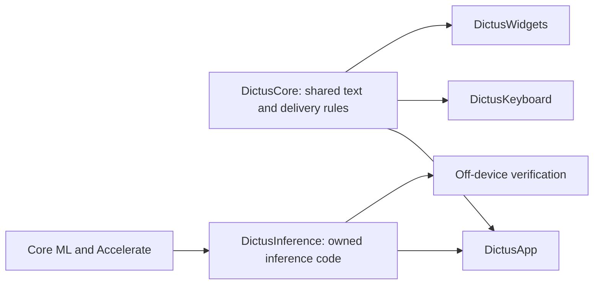

# First-Party Dictus Core Implementation Plan

> October 13 update: the user's new instruction replaces the shared `DictusCore` package with `SyllivraKernel` and the native product with `SyllivraInference`. Follow [the current migration plan](2026-10-13-syllivra-kernel.md) and [checkpoint](../../qa/first-party-core-baseline.md) for live paths. The complete trained-model/third-party-runtime replacement gates in this historical plan remain open.

> **For agentic workers:** Use `executing-plans` to implement this plan task-by-task after implementation is authorized. Use bounded `subagent-driven-development` only when the permitted `sub2api/gpt-6.1-sol` route is available. Main owns serial builds, tests and native inference. Steps use checkboxes for tracking.

**Goal:** Replace the shipped third-party speech, local text-generation and device-helper runtimes with implementations maintained in this repository, while preserving dictation quality, keyboard behavior and improving measured processing latency.

**Architecture:** Keep `DictusCore` as the lightweight shared package. Add one first-party `DictusInference` target inside that same package for native model execution and tokenization; link it to the app and off-device verification only. Apple Core ML executes model graphs; our code owns preprocessing, tokenization, decoding, cache/session lifetime and cancellation. Existing app owners keep audio capture, foreground/background policy, model installation and delivery.

**Tech Stack:** Swift, Foundation, Core ML, Accelerate, AVFoundation, NaturalLanguage, CryptoKit and existing verified first-party C++ where needed. Apple Foundation Models and Translation remain optional native platform integrations. No new third-party production runtime packages.

**Status:** Implementation authorized October 12, 2026. Native artifact validation/loading, the owned Qwen tokenizer, and a cached Qwen conversion recipe with an executed untrained probe are implemented locally; see [the checkpoint](../../qa/first-party-core-baseline.md). Task 1's pretrained Qwen/Whisper graph and numerical parity gates remain open. Phone operation, commits, uploads and publication still require their separate authorization.

## Ownership boundary and scope

The requested outcome is our own runtime implementation. A renamed wrapper or a copied third-party core does not achieve that outcome.

- Production runtime source and model orchestration live in this repository. All external SwiftPM runtime products and their transitive code are removed from the final build graph.
- Apple's installed SDK frameworks and Swift/C++ standard libraries are allowed. This is the native platform route; building our own GPU compiler, numerical library or Neural Engine driver is outside scope.
- The initial models remain licensed pretrained weights. Owning an inference implementation does not give us ownership of those weights or remove their license requirements. Training our own speech and language models is a separate project.
- Conversion and reference-evaluation tools may run in an isolated development environment outside the production app. Their source, binaries and runtime packages must not enter app, keyboard or widget targets.
- Keep optional server processing as the existing explicit URLSession integration. It is neither a mandatory service nor an automatic fallback for native-model failure.
- Inspect retained vendored keyboard code by provenance and use. Replace copied runtime helpers where needed; retain independently implemented code and licensed dictionary data with their required notices.

The plan assumes Apple frameworks and licensed model weights are acceptable. If ownership must also cover trained weights, this plan needs a separate data, training and compute budget before execution.

## Current verified checkpoint

Repository: `/Users/enrico/Documents/GitHub/sAiity-dictus`. Branch: `cursor/keyboard-surface-fixes-a66e`. HEAD: `b696d880`, build 242.

The current tree contains the preceding local performance pass and its QA document. Preserve every existing change. The last executed checkpoint reports 1,947 Core tests in both Debug and Release, one existing ASR capture skip, zero failures, and a signed app/keyboard/widget simulator build. This plan has not rerun those checks or executed any model.

See [processing speed evidence](../../qa/2026-10-12-processing-speed.md). Its approximately 50% reduction is deterministic text-cleanup overhead on a Mac. Its three-to-one engine-call measurement uses a simulated engine. Neither establishes native iPhone inference speed. Apple Foundation Models reported `modelNotReady` during that pass.

## Approaches considered

| Approach | Ownership and cost | Decision |
| --- | --- | --- |
| Our Swift runtime over Apple Core ML and Accelerate | We own application inference logic and avoid shipped external runtime packages. Export support, numerical parity, actual compute placement and speed need verification. | Recommended. |
| Our own Metal tensor library and complete model runtime | Gives more kernel control, with substantially more compiler, memory, numerical, scheduling and maintenance work. Background execution remains subject to iOS policy. | Consider only for a measured operation Core ML cannot handle adequately. |
| Apple Speech/Foundation Models APIs for every operation | Smallest external build graph, but language, device, OS and model-control differences would change the current product contract. | Keep existing optional platform integrations; not a complete replacement for the advertised model catalog. |

## Dependency inventory and replacement map

| Current dependency | Production reach | First-party replacement |
| --- | --- | --- |
| WhisperKit | `DictationCoordinator`, `SpeechModelProtocol`, `ModelManager`, compute-options mapping | Existing Whisper model artifacts plus our mel/token/decoder implementation using Core ML. |
| FluidAudio | `ParakeetEngine`, model preparation/cache locations and downloader helpers | Our Parakeet frontend, predictor/joiner/duration loop, artifact loading and native model compilation. |
| MLX / MLXLLM / MLXLMCommon | `LocalPolishEngine`, Qwen ASR and vendored VAD | Core ML graph execution, bounded per-request KV state and our token-generation loop. |
| `Vendor/QwenASRRuntime` / speech-swift | Qwen encoder/decoder, streaming VAD, tokenizer and weight loading | Our Qwen speech implementation and native VAD state machine. |
| Hub / Swift Transformers / Swift Jinja | Transitive artifact, tokenizer and prompt/template code | Existing URLSession downloader, validated local artifacts, owned tokenizers and the existing explicit prompt envelope. |
| DeviceKit | `KeyboardModePicker`, `Vendored/Models/DeviceContext` | UIKit traits/available geometry and existing `DeviceCapabilities` hardware readings. |
| MLX/FluidAudio transitive libraries | Build graph and linked runtime code, including C/C++ helpers | Disappear after their consumers are replaced; no standalone replacements unless a current caller still needs their behavior. |
| giellakbd-derived keyboard helpers | Six retained Swift helper files have vendored provenance references | Behavioral audit, independent implementation in existing owners, then removal of unused copied helpers. |

`Vendor/QwenASRRuntime` already includes Core ML encoder and decoder files. Those files still import MLX and AudioCommon and are third-party source. Their names do not prove that a complete, independently owned Core ML runtime exists or that it meets our speed/quality gates.

`DictusKeyboard/Vendored/AOSPTrie` describes an AOSP-inspired implementation of a Dictus-specific binary format. Audit its actual provenance and consumers before deciding what must be replaced. Its directory name is not sufficient evidence to delete it or remove attribution.

## Global constraints

- Preserve iOS 17.0 deployment and existing per-feature availability gates. Use iOS 18+ `MLState` only inside availability-guarded implementations. Whisper's iOS 17 path uses explicit cache tensors where needed.
- Preserve existing model IDs, stored preferences, app/keyboard selections, writing styles, personal vocabulary, history and original/result recovery. A legacy identifier such as `whisperKit` may remain a compatibility value after its package is gone.
- Keep all currently offered model families and documented language coverage unless the user separately accepts a catalog reduction. An unsupported architecture is an unfinished migration gate.
- Keep inference models and state out of the keyboard and widget targets. The keyboard's approximate 50 MB constraint remains a device-verification gate.
- Reuse `SpeechModelProtocol`, `PolishEngineProtocol`, `PolishExecution`, `InferenceCancellation`, `StreamingSpeechBuffer`, model/download owners and delivery safeguards. Do not add parallel Manager/Service/Factory/Provider hierarchies.
- Preserve the eight-second shared processing deadline, rejection/fallback behavior, exact original translation fallback, protected facts, uncertainty, multilingual boundaries and no late insertion after cancellation.
- Preserve current Qwen/local-cleanup foreground restrictions until authorized physical testing proves a supported change. Core ML compilation or use of CPU/Neural Engine is not proof of background reliability.
- Never record room audio, inspect private transcripts, download models or change permissions during automated QA. Recognition uses licensed or expressly consented files with recorded hashes and rights.
- No phone operation or installation without explicit direction. Reuse the dedicated simulator `3ED8FD55-D525-45D1-9E1A-4A1354000FC0` for applicable UI work; at most two simulators booted. Do not operate hAiity's simulator or Xcode DeviceHub.
- Websites use Chrome Use; desktop interactions use Computer Use. No substitute browser route. Preserve source, model artifacts, signing artifacts and Git recovery metadata.
- No commit, push, upload, publication, release changes or tester invitations without separate authorization. Each task ends with local evidence and review.

## Module and file boundaries



`DictusInference` is the single additional target, inside the existing package. Its boundary lets the app and Mac verification share real runtime code while extensions retain the small core. There is no new package or repository per model.

| Planned file | Responsibility |
| --- | --- |
| `DictusCore/Package.swift` | App/harness-only inference product, target and tests. Existing Core product stays independently buildable. |
| `DictusCore/Sources/DictusInference/NativeModelArtifacts.swift` | Validate the selected model's owned export manifest, tensor contract, artifact hashes and tokenizer metadata. No downloads or global catalog. |
| `DictusCore/Sources/DictusInference/BytePairTokenizer.swift` | Byte-level BPE and exact special-token behavior used by Qwen and Whisper; architecture-specific pretokenization stays explicit. |
| `DictusCore/Sources/DictusInference/GemmaTokenizer.swift` | Gemma normalization, unigram/SentencePiece behavior and byte fallback. It is a different tokenizer algorithm, not another generic abstraction. |
| `DictusCore/Sources/DictusInference/CoreMLTokenDecoder.swift` | Prefill, per-request KV state, incremental logits, EOS/cap handling for the compatible text-decoder graphs. Share only operations demonstrated common to cleanup and Qwen ASR. |
| `DictusCore/Sources/DictusInference/SpeechFeatures.swift` | Measured Accelerate-based resampling/FFT/mel operations needed by multiple speech families. Preserve each model's window, padding, scaling and mel convention. |
| `DictusCore/Sources/DictusInference/WhisperInference.swift` | Whisper language/task tokens, encoder/decoder interaction, suppression, timestamps and confidence/retry metadata. |
| `DictusCore/Sources/DictusInference/QwenSpeechInference.swift` | Qwen audio embeddings, speech-token framing, decoding and available language metadata. |
| `DictusCore/Sources/DictusInference/ParakeetInference.swift` | Parakeet predictor, joiner, blank/duration advancement and tokenizer state. |
| `DictusCore/Sources/DictusInference/VADInference.swift` | Native VAD recurrent state and segment events consumed by the existing streaming buffer. |
| `DictusCore/Tests/DictusInferenceTests/` | Tokenizer, artifact, tensor/cache, decoder and frontend tests using synthetic/licensed golden fixtures. |

The native source files are concrete algorithms and model families, not interchangeable service layers. Create each file when its task needs it. Keep one-use helpers in that owner; do not scaffold unused types or methods.

The app's existing `LocalPolishEngine`, `QwenSpeechEngine`, `ParakeetEngine`, `TranscriptionService`, `ModelManager`, `ModelRepoDownloader` and `DictationCoordinator` remain the application owners.

## Task 1: Freeze contracts and prove the native artifact path

**Files:** `DictusCore/Package.swift`; `Dictus.xcodeproj/project.pbxproj`; new `NativeModelArtifacts.swift`; new `DictusCore/Tests/DictusInferenceTests/NativeModelArtifactsTests.swift`; existing `DictusApp/Models/ModelRepoDownloader.swift`; new `docs/qa/first-party-core-baseline.md`.

**Consumes:** Current local source, installed artifacts only when expressly in scope, existing model identifiers and `DictationRuntimeMetrics` stages.

**Produces:** A validated export/artifact contract, golden-fixture provenance and reference measurements. Later runtime tasks must use its recorded tensor names, shapes, precision and state layout rather than guess from a model's name.

The package additions are first-party products/targets, inside the current manifest:

```swift
// Add to products, keeping DictusCore and polish-harness:
.library(name: "DictusInference", targets: ["DictusInference"])

// Add to targets:
.target(name: "DictusInference", dependencies: ["DictusCore"],
        path: "Sources/DictusInference"),
.testTarget(name: "DictusInferenceTests", dependencies: ["DictusInference"],
            path: "Tests/DictusInferenceTests", resources: [.copy("Fixtures")])
```

`NativeModelArtifacts` exposes `public init(directory: URL) throws`; an incomplete directory never becomes a usable artifact. Begin its test cycle with a synthetic directory, not an installed user model:

```swift
import XCTest
import DictusInference

final class NativeModelArtifactsTests: XCTestCase {
    func testMissingManifestFailsClosed() throws {
        let directory = FileManager.default.temporaryDirectory
            .appendingPathComponent(UUID().uuidString, isDirectory: true)
        try FileManager.default.createDirectory(at: directory,
                                               withIntermediateDirectories: true)
        defer { try? FileManager.default.removeItem(at: directory) }
        XCTAssertThrowsError(try NativeModelArtifacts(directory: directory))
    }
}
```

Run `swift test --package-path DictusCore --filter NativeModelArtifactsTests` first. Initially the missing implementation prevents success; after adding the real validator, the missing-manifest case must pass and a complete approved manifest must load. Add positive and malformed-manifest cases so an implementation that always throws cannot pass the gate.

- [ ] Record the source revision plus current local diff, model revisions, graph/tokenizer hashes, OS, device, compute units, power/thermal state, prompts and decoding settings. Preserve the preceding performance changes as the starting point.
- [ ] Inventory both direct and transitive linked packages and retained copied runtime sources. Record each item's replacement and the point at which it can leave the build graph.
- [x] Define an owned `native-runtime.json` schema: model/revision bindings, SHA-256 file map, architecture, token metadata, context/output shape, graph input/output/state descriptions, minimum iOS and license record. Real-model exports still need their own verified manifests.
- [x] Add artifact/tensor/vocabulary/cancellation regressions and native loading checks. Incomplete or incompatible artifacts fail before they can be used; native backend admission must retain the existing `artifactsUnavailable` fallback when implemented.
- [x] Add the inference target and its app-only Xcode product dependency; add it to `polish-harness` dependencies in the existing package. Keyboard/widgets retain Core alone. Add a source/build-graph regression and a native-inspection CLI.
- [ ] Prove one Qwen 2.5 0.5B cleanup graph and one Whisper Tiny graph can compile, load and produce known logits with native Core ML. Record the exact conversion recipe and tool/checkpoint versions. Conversion tooling remains outside production targets.
- [ ] Compare unquantized/reference outputs first, then measure the chosen quantized export separately. Record conversion-specific numerical tolerances before accepting results; do not hide quantization changes inside runtime comparisons.
- [ ] Measure baseline preparation, prefill, per-token decoding, deterministic text work and publication separately. Existing timing logs must exclude transcript text unless separately consented.

**Gate:** Both graph contracts are real and reproducible. Token IDs, shapes, cache/state semantics and provenance are verified. If an artifact or authorized recording is missing, report the exact missing input and leave that gate open. No simulated model closes it.

Local continuation: `scripts/convert-native-qwen.py` now exports a single-token
Core ML step with RoPE, grouped-query attention and FP16 KV state. An untrained
two-layer probe passes reference/Core ML logits and fresh-state checks in Python
and Swift. A macOS package-member path normalization bug was fixed. The real
0.5B checkpoint download still receives Chrome `ERR_BLOCKED_BY_CLIENT` at
`us.aws.cdn.hf.co`; the numeric probe does not close the pretrained-model gate.

## Task 2: Replace local text processing first

**Files:** New native tokenizer/decoder files and their tests; existing `DictusApp/Polish/LocalPolishEngine.swift`; `DictusCore/Sources/DictusCore/Polish/LocalCleanupModel.swift`; `PolishContextBudget.swift`; `PolishPromptEnvelope.swift`; `DictusApp/Models/ModelRepoDownloader.swift`; `DictusCore/Sources/polish-harness/main.swift`.

**Interface preserved:** `LocalPolishEngine.prepare() async throws`, `polish(raw:targetLanguage:mode:style:) async throws -> String`, existing `contextFit(...) -> PolishContextFit`, and its `PolishEngineProtocol` conformance. The real tokenizer remains authoritative for context admission.

The owned BPE implementation exposes `init(directory: URL) throws`, `encode(_ text: String) throws -> [Int32]`, and `decode(_ ids: [Int32]) throws -> String`. Freeze exact-ID golden fixtures using the approved model tokenizer before implementing it. Round-trip tests alone are insufficient: encoding and decoding can agree while both use the wrong token IDs. Gemma's normalizer/tokenizer has its own reference output contract.

- [x] Start with Qwen 2.5 0.5B; write golden tokenizer tests before the implementation. Include exact IDs for prompt roles/special tokens, accented/decomposed Unicode, CJK, URLs, code, whitespace and `<<NL>>`. Expose raw token bytes so callers can preserve incomplete UTF-8 between streamed pieces; the decoder's streaming integration remains pending.
- [ ] Implement only the tokenizer model formats the selected exports require. Validate unsupported pretokenizer/normalizer definitions instead of approximating them silently. Implement Gemma's separate algorithm before offering native Gemma.
- [ ] Write cache/prefill tests for a fresh request, multi-token prefill, single-token decode, attention masking, maximum context, EOS, output-cap exhaustion and state reset. Numerical golden tests compare the approved graph's outputs with the recorded reference.
- [ ] Replace MLX container preparation/generation inside the existing actor with native models and reusable input buffers. Reuse model weights within current memory/idle policy; allocate/reset KV state per request. Prompt/style/vocabulary changes cannot reuse an old request's KV history. Include native runtime/artifact revision in the existing result-cache engine identity so a reference result cannot mask a native-model evaluation.
- [ ] Keep `PolishExecution` as the single inference owner. A Core ML prediction may not be preemptible; cancel delivery immediately but retain inference ownership until the prediction exits. Check cancellation and foreground status between steps. Release waits for active work.
- [ ] Keep greedy decoding, real token budgets and truthful truncation errors. Reuse `PolishPromptEnvelope`, all guardrails, region batching and TaskLocal vocabulary. Do not shorten output or skip quality checks to report a faster call.
- [ ] Extend the same proven implementation to Qwen 2.5 1.5B and Gemma 3 1B, preserving Gemma's English-only cleanup restriction. Add each export and tokenizer family to the parity matrix before enabling it.
- [ ] Update artifact verification and existing model-directory reads. Existing MLX-only installs remain intact and receive a truthful explicit conversion/repair requirement; selecting a native runtime must not silently download, delete, replace or falsely mark them Ready.
- [ ] Extend the existing harness engine selection to execute the same native decoder, tokenizer, prompt envelope and guards used by the app. Do not copy the inference loop into the harness. Exercise public cleanup-preservation/multilingual fixtures; count timeout/fallback/rejection as model failures when evaluating cleanup quality.

**Gate:** All three current local-cleanup models work through owned code. Protected facts, language boundaries, formatting and cancellation pass; native latency/memory are recorded. MLX remains a migration dependency only while a still-unreplaced speech consumer needs it.

## Task 3: Replace WhisperKit with our Whisper runtime

**Files:** New `WhisperInference.swift`, `SpeechFeatures.swift` and tests; existing `DictusApp/Audio/SpeechModelProtocol.swift`, `WhisperComputeOptions.swift`, `DictationCoordinator.swift`, `Models/ModelManager.swift`; `DictusCore/Sources/DictusCore/WhisperModelRepository.swift`; existing transcription, model-language and model-preparation tests.

**Interface preserved:** `SpeechModelProtocol.prepare(modelIdentifier:)`, `transcribeDetailed(audioSamples:language:) -> SpeechTranscriptionOutput`, cancellation and both release methods. Input remains Float32 mono at 16 kHz. The existing engine implementation can be renamed `WhisperSpeechEngine`; persisted model IDs remain compatible.

- [ ] Record each supported Whisper variant's encoder, decoder, mel and tokenizer contract, including distilled/turbo differences. Test incompatible exports before accepting a variant as installed.
- [ ] Write synthetic audio golden tests for windowing, padding, FFT/mel/log scaling, silence, gain and region boundaries. Validate the implementation against the reference features, not only the final transcript.
- [ ] Implement the actual autoregressive loop: task/language tokens, prefix handling, token suppression, timestamps/EOS, context resets and confidence values used by current fallback/retry policy. Preserve recognition vocabulary hints and their token limit.
- [ ] Support iOS 17 without unguarded `MLState` references. Keep the existing A12/A13 audio-encoder compute policy; map it to Core ML directly and measure any proposed change independently.
- [ ] Replace WhisperKit loading/prewarming in all current initialization sites: coordinator, model manager and engine. Remove `WhisperKitConfig`, `ModelComputeOptions` and `TranscriptionResult` types from those callers only after native equivalents carry the required metadata.
- [ ] Keep `SpeechRegionSegmenter`, bounded regional gain, low-confidence retry, coverage, multilingual revalidation and `SpeechTranscriptMerger`. Do not force one language or use one giant decode to bypass the region safeguards.
- [ ] Run raw recognition and language/cleanup parity per supported model/language using authorized files. Exercise cancellation during preparation, encoder work, decoding and region retry. Keep original recovery and request/generation checks.

**Gate:** Every advertised Whisper variant has native artifact/tokenizer support and documented device behavior. Cross-app keyboard delivery and background execution require authorized phone evidence; unit/simulator tests do not close those gates.

## Task 4: Replace Qwen ASR and streaming VAD

**Files:** New `QwenSpeechInference.swift`, `VADInference.swift` and tests; existing `DictusApp/Audio/QwenSpeechEngine.swift`; `DictusCore/Sources/DictusCore/DictationRecognizer.swift`, `StreamingSpeechBuffer.swift`, `InferenceCancellation.swift`; existing streaming and language-evidence tests.

**Interface preserved:** `beginRealtime(session:)`, `appendRealtime(_:session:language:)`, `finishRealtime(samples:session:language:)`, `transcribeDetailed(...)`, preparation and release on `QwenSpeechEngine`.

- [ ] Verify complete Core ML encoder and text-decoder exports for Qwen3-ASR 0.6B and 1.7B. A working encoder plus an MLX decoder is not this task's deliverable.
- [ ] Validate audio embeddings, special speech/language tokens, position alignment and prompt-vocabulary framing against the recorded reference. Reuse proven token/cache primitives only where the graph contracts actually match.
- [ ] Implement the existing VAD model with native recurrent state. Test frame size/hop, padding, sample positions, onset/offset, flush, silence, multiple speech runs and forced long-region boundaries. An energy detector is not automatically equivalent to the selected VAD model.
- [ ] Feed native VAD events into the current `StreamingSpeechBuffer`. Preserve stop-time drain, per-region ordering, session identity, cancellation and script-aware merging; never decode already-finished regions again at Stop.
- [ ] Preserve parser behavior for language/source metadata that the model emits and expose its uncertainty honestly. Do not invent language tags to make translation tests pass.
- [ ] Run the complete encoder-to-text path without MLX, SpeechVAD, AudioCommon or speech-swift imports. Keep foreground-only operation until phone tests establish another supported policy.

**Gate:** Both Qwen models, realtime and finalization work without the vendor runtime. Load/inference/cancellation/foreground-loss/memory/accuracy/latency are separate recorded results. Streaming partial success alone cannot close final-transcript parity.

## Task 5: Replace Parakeet and remaining FluidAudio calls

**Files:** New `ParakeetInference.swift` and tests; existing `DictusApp/Audio/ParakeetEngine.swift`, `Models/ModelManager.swift`, `Models/ModelRepoDownloader.swift`; `DictusCore/Sources/DictusCore/ParakeetModelRepository.swift`; existing ASR and model-language tests.

**Interface preserved:** Current `ParakeetEngine` speech contract and `SpeechTranscriptionOutput` regional metadata. Shared model IDs/cache compatibility remain readable.

- [ ] Inventory current Parakeet v2/v3 artifacts and supported languages. Verify encoder, predictor, joiner, blank token, duration-token meanings, frontend and tokenizer metadata for each variant.
- [ ] Write predictor/joiner golden tests, including blank-only frames, nonblank output, duration advancement, maximum symbols per frame, reset between regions and a malformed loop that must terminate safely.
- [ ] Implement the native TDT/transducer decode algorithm. A transformer text loop from Qwen/Whisper cannot replace this decoder.
- [ ] Replace `AsrManager`, `AsrModels` preparation/compilation and cache-location helpers in the existing owners. Use native Core ML compilation and current validated URLSession download behavior.
- [ ] Preserve offline artifact checks, atomic receipts, stable progress, cancellation, partial-download recovery and explicit deletion scope. Existing files survive runtime migration; incompatible files are disclosed before loading.
- [ ] Verify language coverage and raw recognition against authorized fixtures and the reference runtime. Record device memory and warm/cold time separately.

**Gate:** No production caller depends on FluidAudio, including model preparation/downloading. Both Parakeet variants retain their advertised capabilities or the catalog change remains a separate required user decision.

## Task 6: Remove external runtime packages and copied helper cores

**Files:** `Dictus.xcodeproj/project.pbxproj`; existing `DictusApp/Views/KeyboardModePicker.swift`, `DictusKeyboard/Vendored/Models/DeviceContext.swift`, `KeyboardHeightProvider.swift`, `KeyboardViewController.swift`; `.github/workflows/ci.yml`; `ci_scripts/ci_post_clone.sh`, `ci_pre_xcodebuild.sh`; `scripts/generate-license-notices.swift`; `DictusApp/Resources/OpenSourceNotices.json`; the ownership inventory from Task 1.

**Removals after parity:** `Vendor/QwenASRRuntime` and its package products; remote WhisperKit, FluidAudio, DeviceKit and mlx-swift-lm package references; now-unneeded transitive packages; `scripts/patch-fluidaudio-swift5.sh` and its CI/build hooks. Remove copied keyboard helpers only after their actual consumers have been replaced.

- [ ] Replace DeviceKit calls with existing device readings, UIKit traits and effective keyboard/window geometry. Preserve iPad categories, landscape behavior, safe areas, app-on-iPad behavior and an honest generic name for unknown hardware. Use current owners; no device registry.
- [ ] Audit each retained vendored keyboard helper and C++ source against its provenance and call sites. Independently reimplement copied runtime logic whose behavior is still required; remove genuinely unused copied files. Keep licensed dictionary assets and independently implemented code with accurate notices.
- [ ] Exercise layout, touch routing, long press/repeat, language layouts and native haptic behavior before cutting the helper dependencies. Physical feel remains a separate gate.
- [ ] Delete external package/product/build references only after the last live consumer has moved. Verify the `DictusInference` product added in Task 1 remains app-only; keep keyboard/widgets linked solely to lightweight Core and Apple frameworks.
- [ ] Update CI package caching/resolution, remove FluidAudio patch requirements and make license generation consume the remaining actual source/data inventory. Preserve notices for retained Dictus, dictionary/model data and any genuinely retained derived code.
- [ ] Add an executable dependency/ownership check: reject external SwiftPM runtime objects, forbidden runtime imports/products, linked vendor objects and stale vendor code in production source phases. Check the static link map as well as dynamic framework listings; `otool -L` alone cannot prove absence of statically linked packages.
- [ ] Build from fresh DerivedData to prove that success does not depend on old package artifacts. Preserve historical archives and all Git recovery state; no history rewriting or blanket repository cleaning.

**Gate:** The production app, keyboard and widgets ship zero external runtime-core packages or retained third-party runtime copies. All maintained runtime code has documented provenance. Model/dictionary licenses remain visible, and historical identifier strings/documents are not confused with a linked dependency.

## Task 7: Validate quality, speed and complete cutover

**Files:** Existing Core and new inference test suites; `docs/product-beta-protocol.md`; `docs/qa/first-party-core-baseline.md`; new `docs/qa/first-party-core-acceptance.md`; `scripts/summarize-dictation-timings.swift`; existing model capability/copy tests and product-quality fixtures.

- [ ] Run Debug and Release deterministic suites. Every new decoder/parser/state branch needs a regression; unchanged names/copy do not need snapshot tests that merely mirror implementation.
- [ ] Compare exact tokenizer IDs and approved tensor/cache golden outputs. Verify silence, noise, numbers, names, negation, URL/code, punctuation/newlines, unfinished speech, language switches, translation fallback and approved vocabulary on the real pipeline.
- [ ] Run signed app/keyboard/widget simulator builds and strict signature/version checks. Compile the iOS 17 path and supported newer paths. Review fresh linker/package evidence for the zero-runtime-dependency gate.
- [ ] With explicit phone authorization and approved recordings, run matched before/after sessions: at least 20 warm runs and five cold preparations per model/device/context group. Record Stop-to-insertion, load, prefill, decoding, cleanup, failed/cancelled/fallback outcomes, memory and thermal/power state. Interleave reference/native runs to limit drift.
- [ ] Use at least a constrained supported phone and a current Neural Engine phone for acceptance. Keep app foreground, keyboard/cross-app background and memory/thermal cases separate. Preserve current unsupported-mode disclosures until their own gates pass.
- [ ] Obtain independent native-language meaning review of changed recognition/cleanup outputs. Score WER/CER only for a model's documented eligible languages, plus the existing product usable-unchanged/fact-preservation outcomes. Do not average a failed language away in an aggregate score.
- [ ] Record the remaining physical keyboard, mic-on haptic, denied Full Access, field/default-tone, landscape, PiP/system Live Activity and delivery gates independently of model throughput.
- [ ] Update capability explanations and export/readiness documentation from executed evidence. Release preparation, signing/archive work, upload and tester communication remain separately authorized actions.

### Acceptance targets

These are proposed engineering targets, not measured promises:

| Measure | Required evidence/target |
| --- | --- |
| Runtime ownership | Zero external runtime-core package products or copied runtime implementations in final production source/link graphs. |
| Deterministic safety | All existing and new relevant checks pass; no dropped protected facts, stale insertion or private-text logging introduced. |
| Recognition | Paired per-language WER/CER increase no more than 0.5 percentage points, with no new protected-fact/silence-hallucination failures. Independent meaning review can reject a numerically acceptable run. |
| Cleanup quality | No reduction in reviewed usable-unchanged outcomes; preserve the existing conservative fallback. |
| Processing speed | Target at least 25% lower warm processing p50 for the selected native model, with p95 no worse than the matched reference. Measure successful output and fallback rates together. |
| Speech speed | Target at least 15% lower warm ASR p50, with p95 and cold preparation no worse than the matched reference. |
| Memory/background | No jetsam or overlapping inference; memory and foreground/background outcomes must pass the device matrix before capability claims change. |

If speed or conversion gates fail, record the failure and optimize that measured stage. Do not call the migration complete because it builds, owns more code or returns fallback earlier. A decision to accept slower execution or reduce the model catalog needs a separate product decision.

## Verification commands and execution order

Run from `/Users/enrico/Documents/GitHub/sAiity-dictus`. Create a fresh task artifact directory using `mktemp -d /tmp/saiity-first-party-core.XXXXXX` and record its returned path. Set `DEVELOPER_DIR=/Applications/Xcode.app/Contents/Developer` per command. Keep tests, project builds and native inference serial.

```sh
swift test --package-path DictusCore -c debug --scratch-path /tmp/saiity-first-party-core-debug
swift test --package-path DictusCore -c release --scratch-path /tmp/saiity-first-party-core-release
swift scripts/summarize-dictation-timings.swift --self-test
git diff --check
```

Expected: zero failures in deterministic suites and timing-parser self-check. Document every skip; model/phone skips leave their acceptance gates open.

During migration, keep the existing pinned dependency checkout/FluidAudio compatibility step until its last consumer is gone. After Task 6, a fresh simulator build must need only local package products and Apple frameworks:

```sh
xcodebuild build -project Dictus.xcodeproj -scheme DictusApp -configuration Debug \
  -destination 'generic/platform=iOS Simulator' \
  -derivedDataPath /tmp/saiity-first-party-core-derived
codesign --verify --deep --strict \
  /tmp/saiity-first-party-core-derived/Build/Products/Debug-iphonesimulator/DictusApp.app
```

Expected: `BUILD SUCCEEDED` and valid app plus embedded extension signatures. No signing-disable flags on artifacts used for native execution. Verify Release compilation and the iOS 17/newer availability cases separately.

Static preflight for remaining runtime imports:

```sh
rg -n 'import (WhisperKit|FluidAudio|MLX[A-Za-z0-9_]*|Qwen3ASR|SpeechVAD|AudioCommon|DeviceKit|Hub|Tokenizers|Transformers)' \
  DictusApp DictusCore/Sources DictusKeyboard DictusWidgets
swift package dump-package --package-path DictusCore
plutil -convert json -o - Dictus.xcodeproj/project.pbxproj | \
  jq '[.objects[] | select(.isa == "XCRemoteSwiftPackageReference")] | length'
```

Expected after Task 6: no forbidden imports, no external package dependencies and zero remote runtime package references. Supplement these checks with source-phase, link-map and artifact inspection; names-only searches are not the ownership proof.

## Delivery order and cost

1. Freeze provenance, artifact contracts and native graph feasibility.
2. Deliver owned local processing, starting with Qwen 2.5 0.5B.
3. Deliver owned Whisper recognition for the keyboard path.
4. Deliver Qwen streaming/VAD, then Parakeet's different transducer algorithm.
5. Remove device/helper/vendor dependencies and all transitive runtime code.
6. Close measured phone quality/performance and production build-graph gates.

This is a substantial runtime migration. Budget several engineering weeks for a verified processing-plus-Whisper milestone, and multiple months for full current-catalog and device parity with one engineer. The first feasibility gate should produce a narrower estimate using actual exports, tooling and authorized hardware. Converter/compiler limitations and tokenizer/numerical parity are the main uncertainties; custom code is not inherently faster than the current optimized libraries.

The first reviewable implementation milestone is one real Qwen cleanup model running through our code, with its golden tokenizer/cache checks, accepted output, cold/warm timings and memory evidence. It is a milestone, not completion of third-party-core removal.
